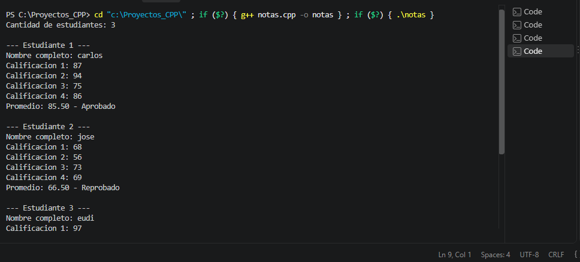
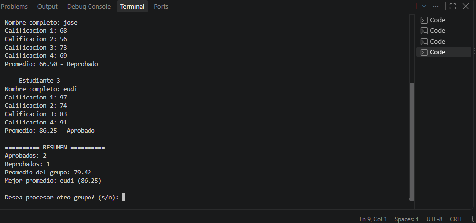
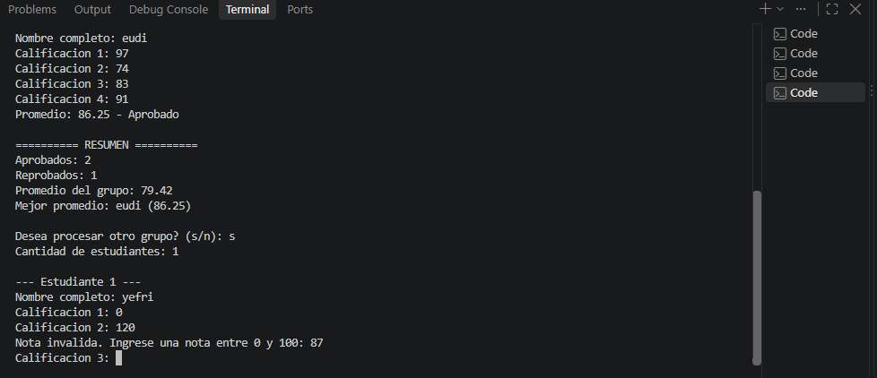

# Sistema de Control de Calificaciones

## 1. Datos del estudiante

- **Nombre:** Carlos Eduardo de la Rosa Limas
- **Matrícula:** 2025-2467
- **Asignatura:** Lógica de Programación
- **Profesor:** Gamalier Reyes del Carmen
- **Fecha:** 18/11/2026

## 2. Descripción del programa

El Sistema de Control de Calificaciones es un programa desarrollado en C++ que permite registrar las calificaciones de un grupo de estudiantes de un centro educativo.

Su finalidad es facilitar el cálculo de los promedios, identificar a los estudiantes aprobados y reprobados y mostrar un resumen general de los resultados obtenidos.

## 3. Datos de entrada

El programa solicita los siguientes datos:

- Cantidad de estudiantes.
- Nombre completo de cada estudiante.
- Cuatro calificaciones por estudiante, con valores entre 0 y 100.
- Respuesta para indicar si se desea procesar otro grupo (s/n).

## 4. Proceso del programa

El programa realiza los siguientes procesos:

1. Solicita la cantidad de estudiantes y verifica que sea mayor que cero.
2. Solicita el nombre completo de cada estudiante.
3. Registra cuatro calificaciones por estudiante.
4. Comprueba que cada calificación esté entre 0 y 100.
5. Calcula el promedio individual.
6. Determina si el estudiante está aprobado o reprobado. La nota mínima para aprobar es 70.
7. Cuenta los estudiantes aprobados y reprobados.
8. Calcula el promedio general del grupo.
9. Identifica al estudiante con el promedio más alto.
10. Pregunta si se desea procesar otro grupo.

## 5. Datos de salida

Al finalizar el registro, el programa muestra:

- Promedio de cada estudiante.
- Estado de aprobado o reprobado.
- Cantidad total de aprobados.
- Cantidad total de reprobados.
- Promedio general del grupo.
- Nombre y promedio del estudiante con la calificación más alta.

Los resultados numéricos se muestran con dos decimales.

## 6. Uso de estructuras repetitivas

### Bucle while

Se utiliza para repetir el programa cuando el usuario desea procesar otro grupo.

También se emplea para validar que la cantidad de estudiantes sea mayor que cero y que las calificaciones estén dentro del rango permitido de 0 a 100.

### Bucle for

Se utiliza para recorrer la cantidad de estudiantes que se van a registrar.

También permite solicitar las cuatro calificaciones correspondientes a cada estudiante.

Estas estructuras permiten repetir instrucciones y controlar los datos ingresados sin utilizar arreglos ni vectores.

## 7. Contadores y acumuladores

El programa utiliza contadores y acumuladores para organizar los resultados:

- **aprobados:** cuenta los estudiantes que obtienen un promedio de 70 o más.
- **reprobados:** cuenta los estudiantes con promedio menor de 70.
- **sumaNotas:** acumula las cuatro calificaciones de cada estudiante.
- **sumaPromedios:** acumula los promedios individuales para calcular el promedio general.
- **promedioMayor:** almacena el promedio más alto encontrado.

## 8. Evidencias de ejecución

Las siguientes evidencias muestran el funcionamiento del programa:

### Registro de estudiantes

### Resumen general de calificaciones

### Validación de calificaciones y repetición del programa

## 9. Lenguaje y herramientas utilizadas

- **Lenguaje de programación:** C++.
- **Editor de código:** Visual Studio Code.
- **Repositorio:** GitHub.
- **Librerías utilizadas:** iostream, string e iomanip.

## 10. Conclusión

La realización de este proyecto permitió poner en práctica el uso de estructuras repetitivas en C++, especialmente los bucles for y while.

También permitió comprender la importancia de utilizar contadores, acumuladores y condiciones para validar información y obtener resultados correctos.

El sistema facilita el registro y control de las calificaciones de los estudiantes, ofreciendo un resumen claro de su rendimiento académico.
